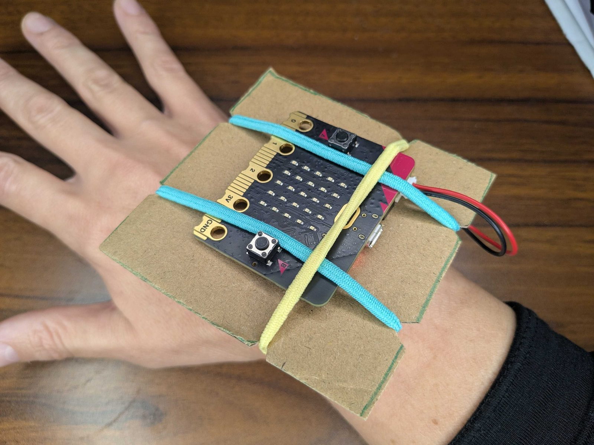

## What you will make

Make a wearable that turns your moves into sound. Tilt and shake to make music, then play with your friends.

<html>

<iframe style="position: absolute; top: 0; left: 0; right: 0; width: 100%; height: 100%; border: none;" src="https://www.youtube.com/embed/PX5PS9-gas0?rel=0&cc_load_policy=1" allowfullscreen allow="accelerometer; autoplay; clipboard-write; encrypted-media; gyroscope; picture-in-picture; web-share">
</iframe>

 
</html>

> [!PRINTONLY]
>
> {:width="450px"}

### You will need

**For the wearable:**
- A printed [template](resources/shake-and-play-template.pdf){:target="_blank"}
- Thick cardboard
- Pencil
- Ruler if you are drawing the template by hand
- Tape
- 3 hair elastics
- Scissors
- Pens or craft materials to decorate (optional)

**For the micro:bit:**
- V2 micro:bit and a USB cable
- Battery pack and 2 AAA batteries