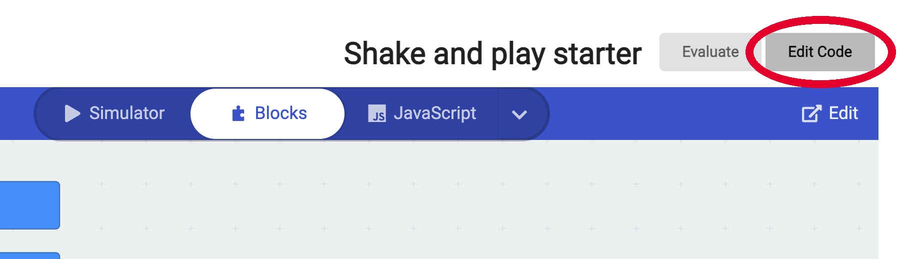
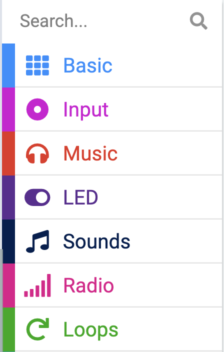
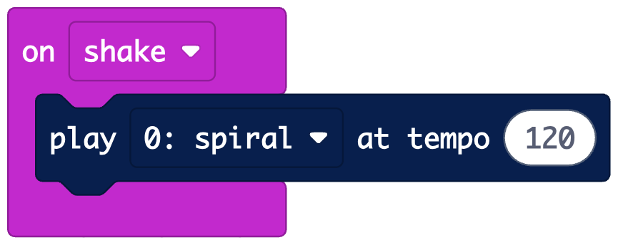
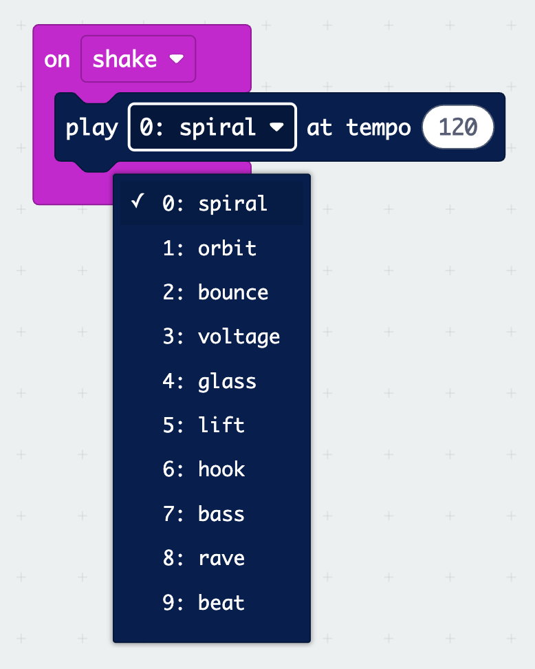
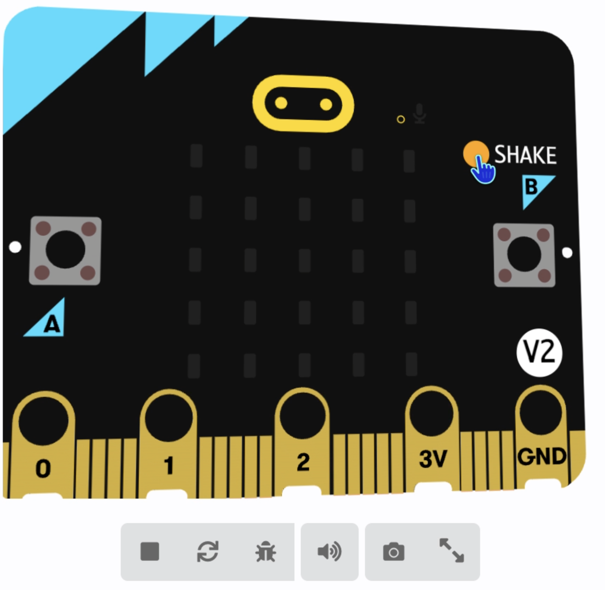

## Shake a sound

Pick a sound and play it with a shake.

> [!TASK]
>
> Open the starter project at [rpf.io/shake-starter](https://rpf.io/shake-starter){:target="_blank"}.

> [!TASK]
>
> Click **Edit Code**.
>
> {:width="450px"}

> [!TASK]
>
> From the `Basic`{:class='microbitbasic'} menu, drag an `on start`{:class='microbitbasic'} block into the code area.
>
> From the `Music`{:class='microbitmusic'} menu, drag a `set volume`{:class='microbitmusic'} block inside it. Change the volume to `255`.
>
> ```microbit
> music.setVolume(255)
> ```

The starter project has a **custom menu** called `Sounds`{:class='microbitserial'}. It has twelve sounds for you to use.

{:width="200px"}

> [!TASK]
>
> From the `Input`{:class='microbitinput'} menu, drag an `on shake`{:class='microbitinput'} block into the code area.
>
> ```microbit
> input.onGesture(Gesture.Shake, function () {
> })
> ```

> [!TASK]
>
> From the `Sounds`{:class='microbitserial'} menu, drag a `play`{:class='microbitserial'} block inside the `on shake`{:class='microbitinput'} block.
>
> {:width="450px"}

> [!TASK]
>
> Click the drop-down menu in the `play`{:class='microbitserial'} block and choose a sound. Scroll down to see all twelve.
>
> {:width="450px"}

**Test:** Click **SHAKE** on the simulator and check that your sound plays.

{:width="300px"}
