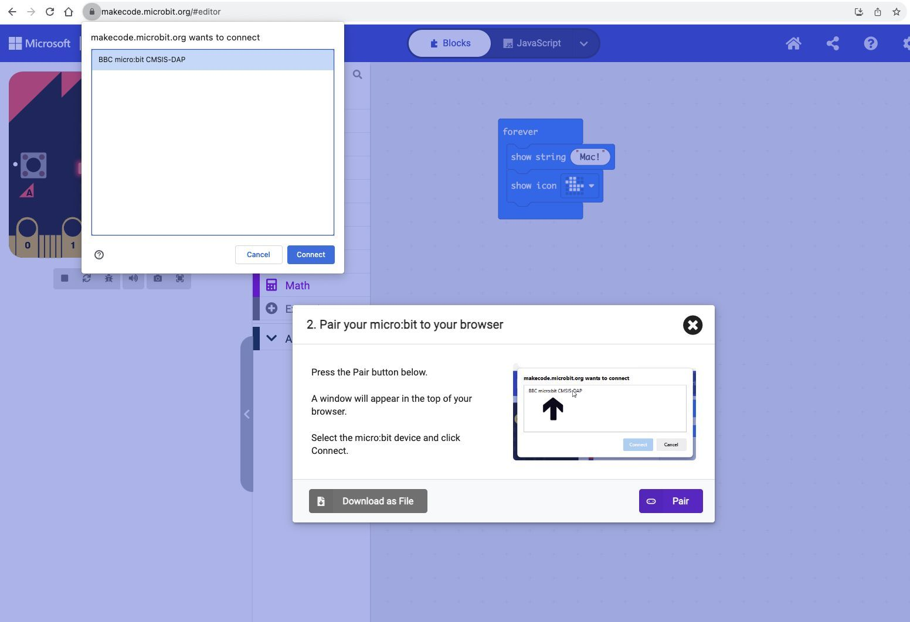
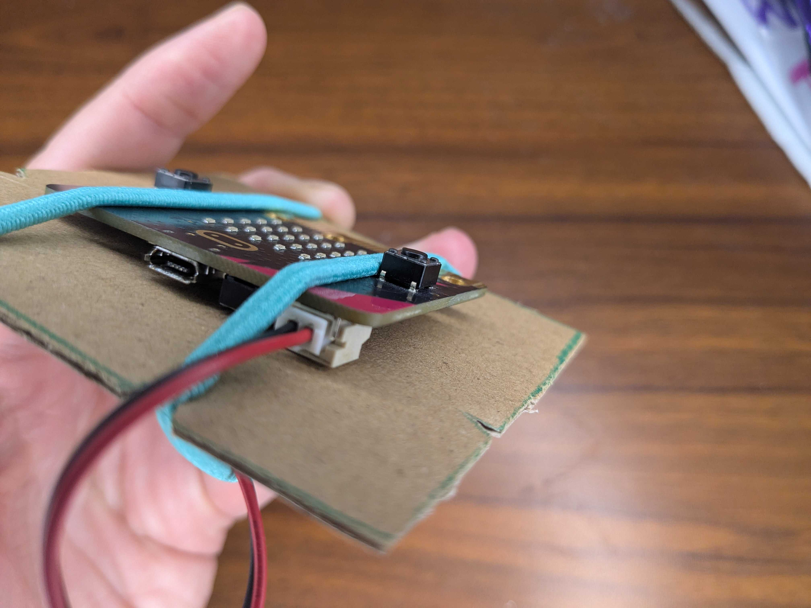

## Play on your micro:bit

Download your code to the micro:bit and play it away from the computer.

> [!TASK]
>
> Plug the small end of the USB cable into the micro:bit. Connect the other end to your computer.
>
> {:width="450px"}

> [!TASK]
>
> Click **Download** at the bottom of the MakeCode editor.
>
> {:width="300px"}

> [!TASK]
>
> The first time you download, pair your micro:bit with the computer.
>
> 1. Click **Pair**.
> 2. Select your micro:bit and click **Connect**.
> 3. Click **Download**.
>
> -- REPLACE THIS IMAGE with your own pairing screenshot. This one is from the slides and shows someone else's project (show string "Mac!"). Make it bigger if the text is too small.
>
> {:width="450px"}

> [!TASK]
>
> Plug the battery pack into the micro:bit. Keep it plugged in, even when the USB cable is in.
>
> {:width="450px"}

> [!TASK]
>
> Hold the USB plug, not the cable, and gently pull it out of the micro:bit.
>
> {:width="450px"}

> [!TIP]
>
> Use the USB cable for downloading code, then take it out to test. Testing with the cable plugged in can break the USB port.

**Test:** Press **B** to turn the sound off and **A** to turn it back on.
