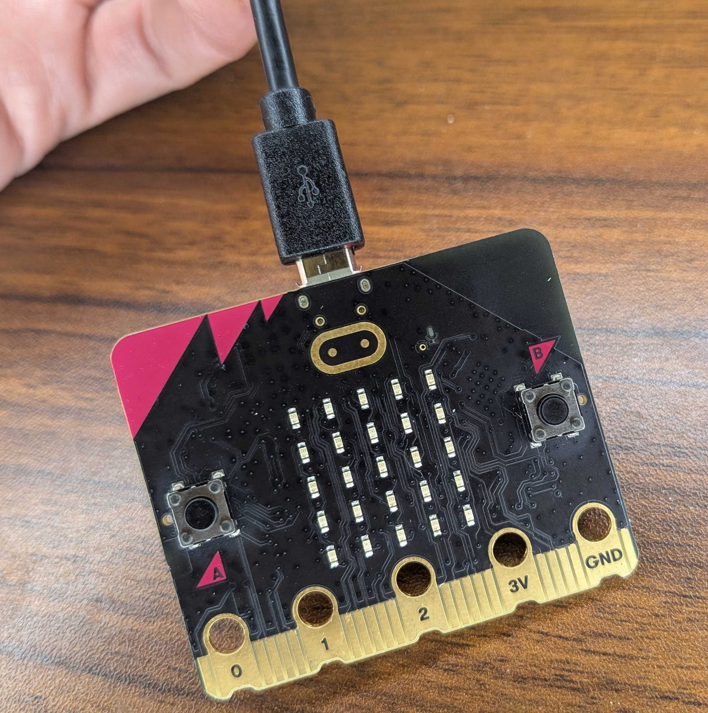
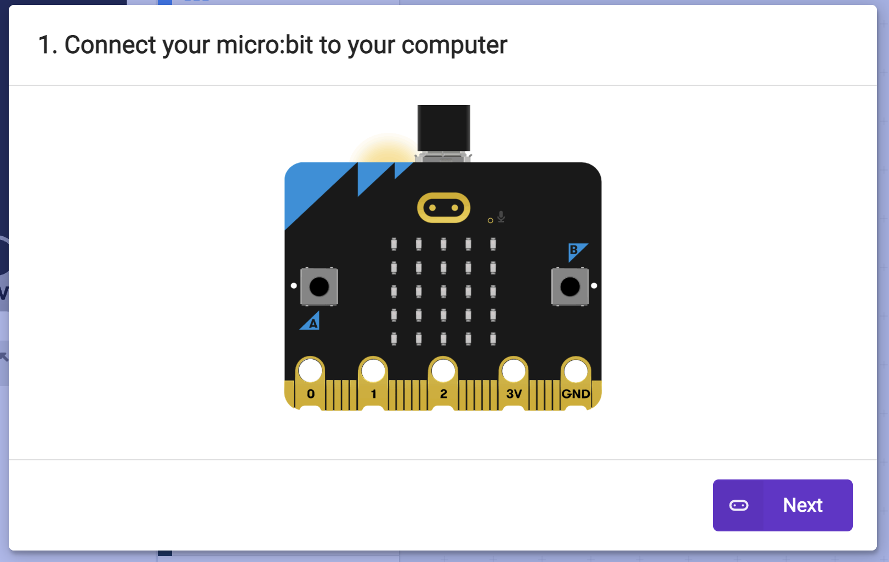
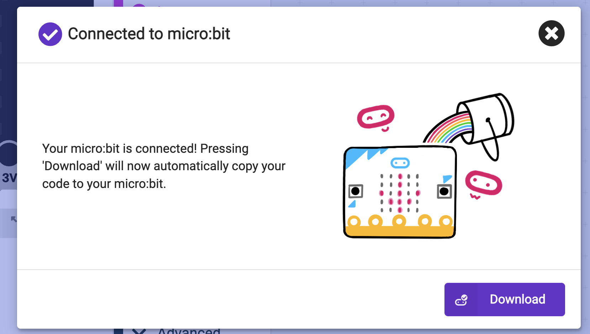

## Play on your micro:bit

Download your code to the micro:bit and play.

> [!TASK]
>
> Plug the small end of the USB cable into the micro:bit. Connect the other end to your computer.
>
> {:width="450px"}

> [!TASK]
>
> Click **Download** at the bottom of the MakeCode editor.
>
> {:width="300px"}

The first time you download, MakeCode asks you to pair your micro:bit with the computer.

> [!TASK]
>
> A screen will pop up to Connect your micro:bit. Do this then click **Next**.
>
> {:width="450px"}

> [!TASK]
>
> Click **Pair**.
>
> {:width="450px"}

> [!TASK]
>
> Select your micro:bit, then click **Connect**.
>
> {:width="450px"}

> [!TASK]
>
> Click **Download**.
>
> {:width="450px"}

**Test:** Shake the micro:bit to check your sound plays.

