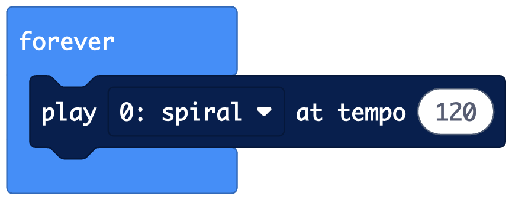
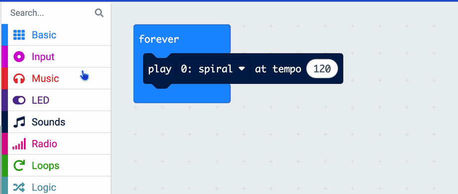

## Change the tempo

Use movement to change the tempo of your sound.

> [!TASK]
>
> From the `Sounds`{:class='microbitserial'} menu, drag a `play`{:class='microbitserial'} block inside the `forever`{:class='microbitbasic'} block.
>
> {:width="450px"}

**Test:** Listen to the simulator. The sound plays over and over.

> [!TASK]
>
> Click the drop-down menu in the `play`{:class='microbitserial'} block in the `forever`{:class='microbitbasic'} block and choose a sound for your loop.
>
> {:width="300px"}

> [!INFO]
>
> The **tempo** is how fast the sound plays. Lower numbers are slower, and higher numbers are faster.

> [!TASK]
>
> Experiment with the tempo in the `play`{:class='microbitserial'} block in the `forever`{:class='microbitbasic'} block. Try `60`, then try `120`.
>
> Add image

> [!TIP]
>
> A tempo of `0` is silent.

**Test:** Listen to the simulator. The tempo changes.

Now let your movement choose the number.

> [!TASK]
>
> From the `Input...more`{:class='microbitinput'} menu, drag a `rotation (°) pitch`{:class='microbitinput'} block into the tempo number in the `play`{:class='microbitserial'} block.
>
> Change `pitch` to `roll`.
>
> add image
>

Add tip here -  to 

> [!TIP]
>
> **Roll**
>
> {:width="450px"}

> [!TASK]
>
> Plug in the USB cable and click **Download**.
>
> {:width="300px"}

> [!TASK]
>
> Hold the USB plug, not the cable, and gently pull it out of the micro:bit.

**Test:** Tip the micro:bit to the side. Check the tempo changes.

> [!DEBUG]
>
> If nothing changes, check which way your micro:bit is facing. Try `pitch` instead of `roll`, or tip it the other way.
