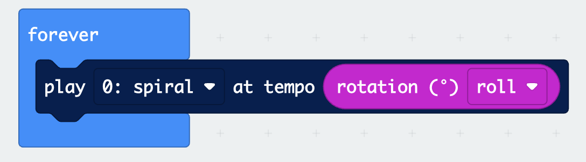

## Change the tempo

Use movement to change the tempo of your sound.

> [!TASK]
>
> Move `play`{:class='microbitserial'} inside the `forever`{:class='microbitbasic'} block.
>
> {:width="450px"}

**Test:** Listen to the simulator. The sound should play over and over.

> [!TASK]
>
> Click the drop-down menu in the `play`{:class='microbitserial'} and choose a sound.

> [!INFO]
>
> The **tempo** is how fast the sound plays. Lower numbers are slower, and higher numbers are faster.

> [!TASK]
>
> Experiment with the tempo in the `play`{:class='microbitserial'} block in the `forever`{:class='microbitbasic'} block. Try changing the number and listen to how the tempo changes.

### Use movement to the change the tempo.

> [!TASK]
>
> From the `Input...more`{:class='microbitinput'} menu, drag a `rotation pitch`{:class='microbitinput'} block into the tempo number.
>
> {:width="450px"}

> [!TASK]
>
> Use the drop-down to select `roll`{:class='microbitinput'}. **Roll** is movement from side to side.
>
> {:width="450px"}

> [!TIP]
>
> Rotate it to `0` and you can stop it playing.

> [!TASK]
>
> Click **Download**.
>
> {:width="300px"}

**Test:** Tip the micro:bit to the side. Check the tempo changes when you move.

> [!DEBUG]
>
> If nothing changes, check which way your micro:bit is facing. Try `pitch`{:class='microbitinput'} instead of `roll`{:class='microbitinput'}, or tip it the other way.
