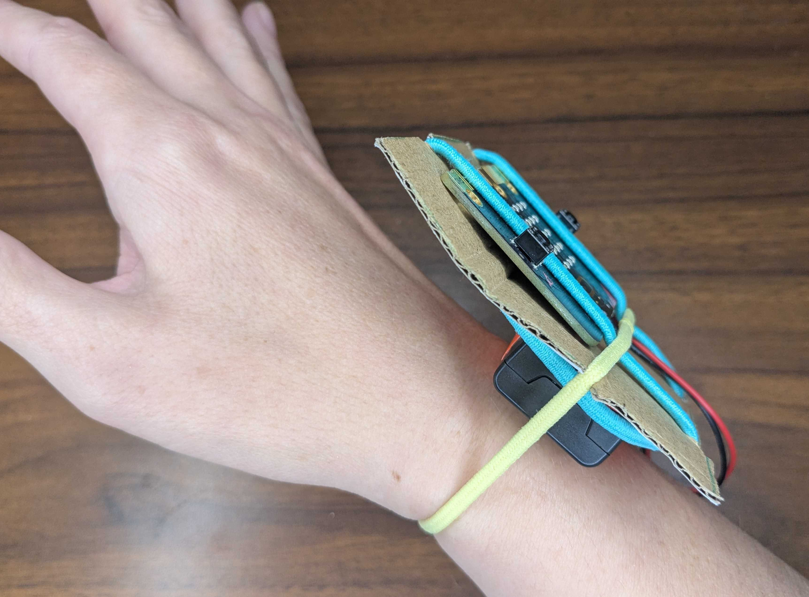

## Make your wearable

Build a holder for your micro:bit that you can wear.

> [!TASK]
>
> Decide how you will make your holder:
>
> - **Print a template.** [Download the template](resources/shake-and-play-template.pdf){:target="_blank"} and print it at **100%**. 
> - **Measure and draw.** No printer? Use the measurements on the [template](resources/shake-and-play-template.pdf){:target="_blank"} to draw the shape straight on to the cardboard with a ruler.
> - **Laser cut.** [Download the laser cutting file](resources/shake-and-play-template.svg){:target="_blank"}. Use it as a template, or as your board.
> - **3D print.** [Download the 3D printing file](resources/shake-and-play-template.stl){:target="_blank"}. It prints flat and is 3 mm thick. Use it as a template, or as your board.

> [!TASK]
>
> If you are printing, cut out the template from the sheet.
>
> {:width="450px"}

> [!TASK]
>
> Draw around the template onto thick card.
>
> {:width="450px"}

> [!TASK]
>
> Decorate the cardboard to make it your own. Try patterns, colours or a character.
>
> {:width="450px"}

> [!TIP]
>
> Draw around the micro:bit first, so you know which parts to decorate.
>
> {:width="450px"}

> [!TASK]
>
> Cut out your board, including the small notches for the elastics.
>
> {:width="450px"}

> [!TASK]
>
> Tape the battery pack to the back of the board.
>
> {:width="450px"}

> [!TASK]
>
> Put the micro:bit on the other side, in the middle of the board.
>
> Stretch two hair elastics over the micro:bit and into the notches at the top and bottom.
>
> {:width="450px"}

> [!TASK]
>
> Plug the battery pack into the micro:bit.
>
> {:width="450px"}

> [!TASK]
>
> Stretch the third elastic across the micro:bit and into the notches on each side. This holds the micro:bit to your hand.
>
> {:width="450px"}

> [!TASK]
>
> Wear the board on your wrist, so that you can use your arm to control it.
>
> {:width="450px"}

**Test:** Twist your wrist, then shake it gently. Check the micro:bit stay in place.

> [!TIP]
>
> To switch off your wearable, unplug the battery pack.
