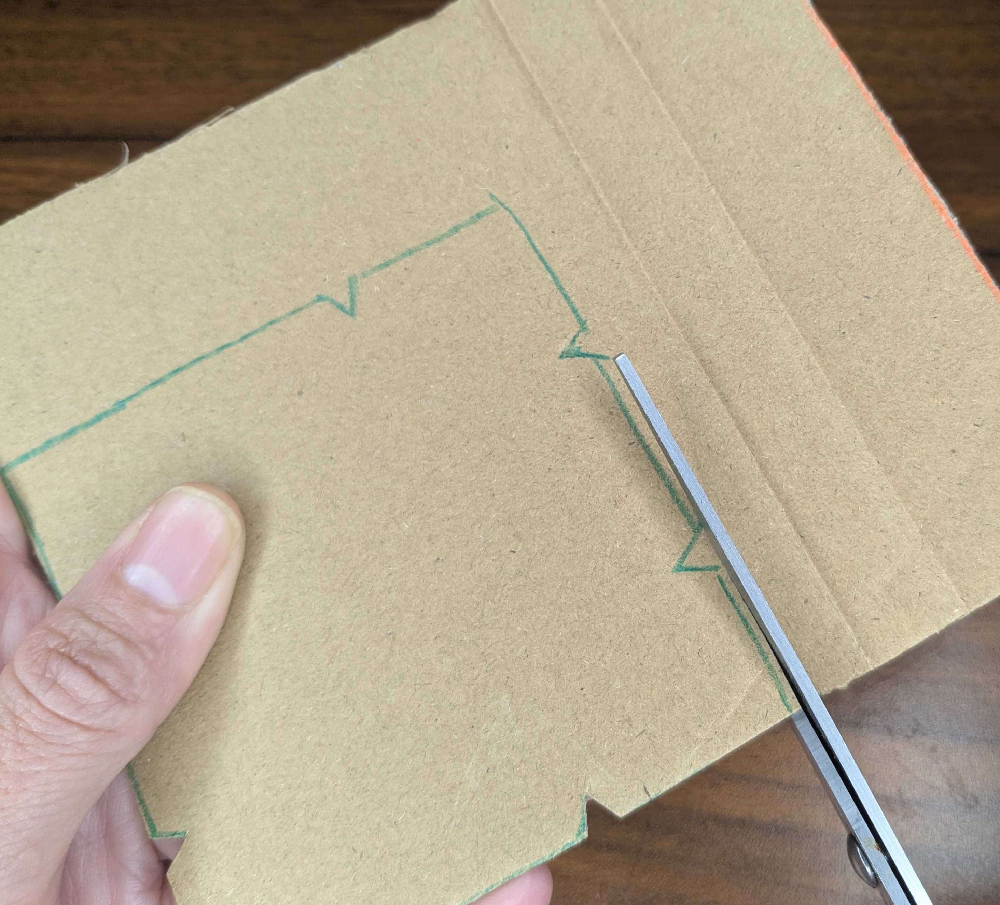

## Make your wearable

Build a holder for your micro:bit that you can wear.

{:width="450px"}

> [!TASK]
>
> Draw and cut the holder out of thick cardboard.
>
> - **Print a template.** [Download the template](resources/shake-and-play-template.pdf){:target="_blank"} and print it. Cut out one template, draw around it on cardboard, then cut out the cardboard.
> - **Measure and draw.** No printer? Use the measurements on the [template](resources/shake-and-play-template.pdf){:target="_blank"} to draw the shape straight on to the cardboard with a ruler.
>
> {:width="450px"}
>
> {:width="450px"}
>
> {:width="450px"}

> [!TIP]
>
> If you have the tools, you can 3D print or laser cut the template.
>
> - **Laser cut.** [Download the laser cutting file](resources/shake-and-play-template.svg){:target="_blank"}. Use it as a template, or as your board.
> - **3D print.** [Download the 3D printing file](resources/shake-and-play-template.stl){:target="_blank"}. It prints flat and is 3 mm thick. Use it as a template, or as your board.

> [!TASK]
>
> Tape the battery pack to the board.
>
> {:width="450px"}

> [!TASK]
>
> Plug the battery pack into the micro:bit. Keep it plugged in, even when the USB cable is in.

> [!TASK]
>
> Hold the USB plug, not the cable, and gently pull it out of the micro:bit.
>
> {:width="450px"}

> [!TIP]
>
> Use the USB cable for downloading code, then take it out to test. Testing with the cable plugged in can break the USB port.

> [!TASK]
>
> Put the micro:bit on the other side, in the middle of the board.
>
> Stretch two hair elastics over the micro:bit and into the notches at the top and bottom.
>
> {:width="450px"}

> [!TIP]
>
> Keep the **A** and **B** buttons and the USB port clear of the elastics so you can still use them.

> [!TASK]
>
> Plug the battery pack into the micro:bit. Keep it plugged in, even when the USB cable is in.
>
> {:width="450px"}

> [!TASK]
>
> Stretch the third hair elastic across the micro:bit and into the notches on each side.
>
> {:width="450px"}

> [!TASK]
>
> Wear the board on your wrist, so that you can use your arm to control it.
>
> {:width="450px"}

**Test:** Twist your wrist, then shake it gently. Does the micro:bit stay in place?

> [!TASK]
>
> Decorate your wearable to make it your own.
