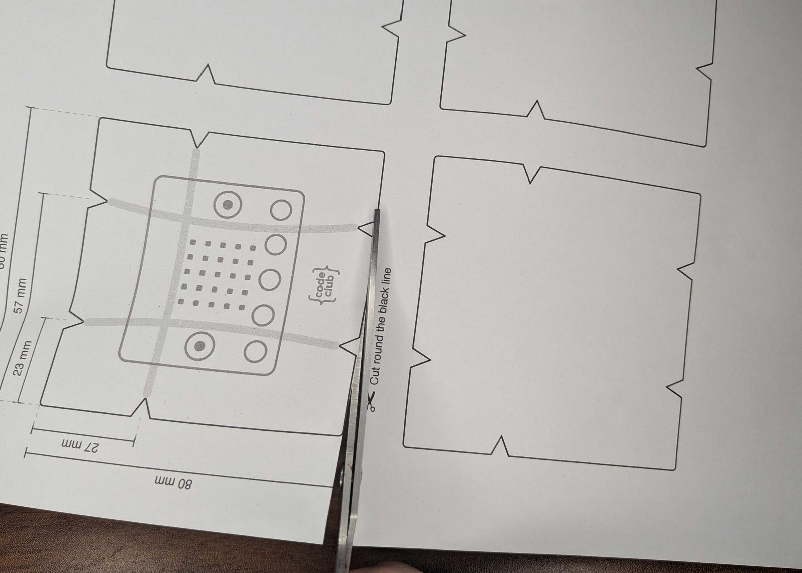
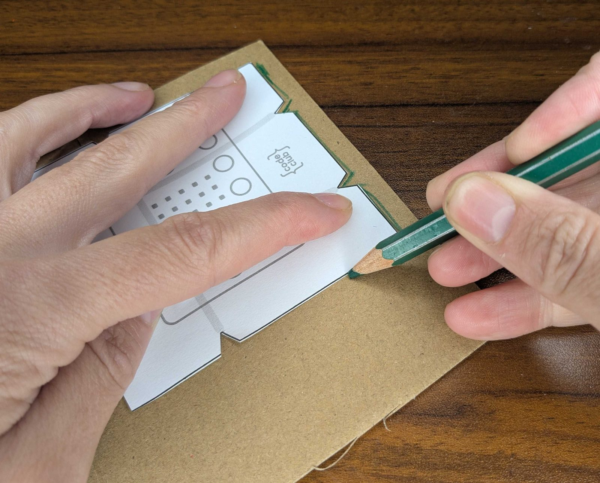
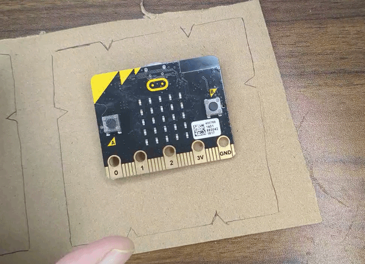
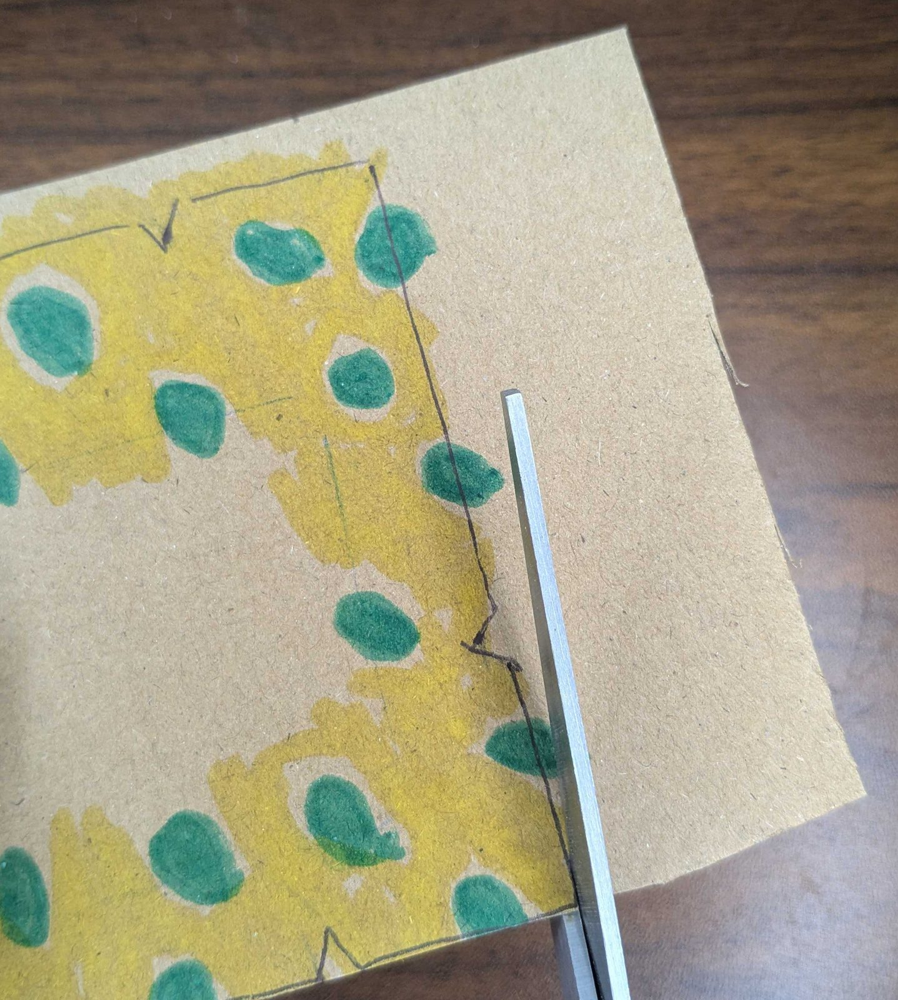
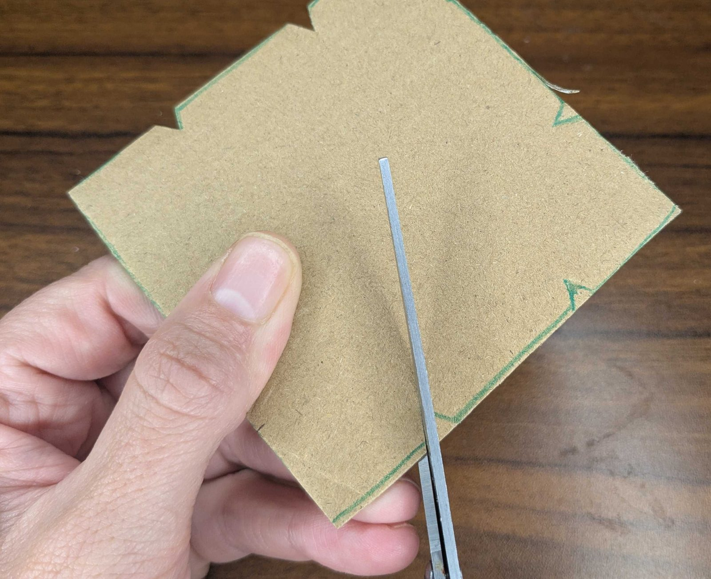
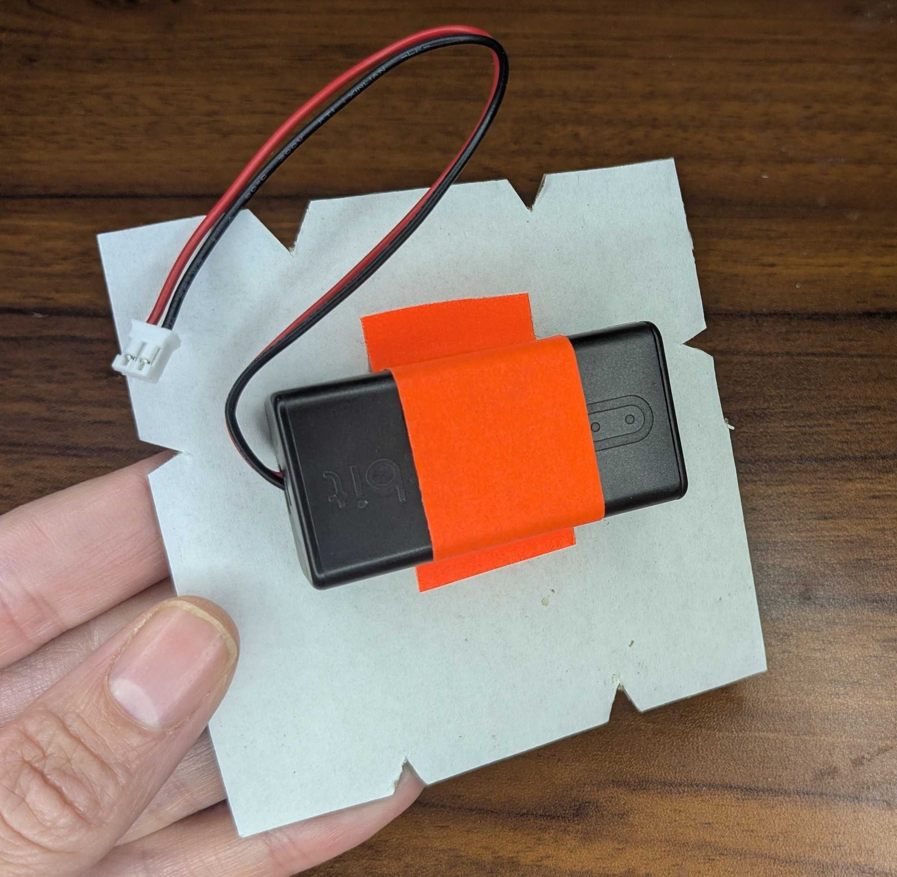
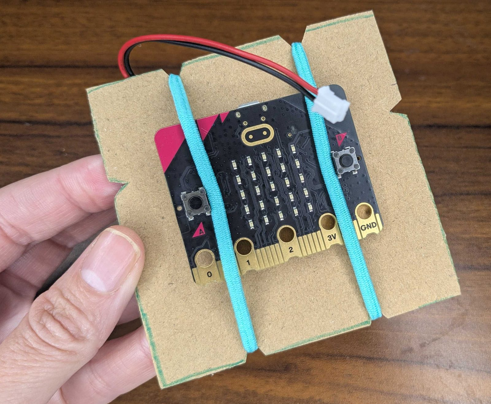
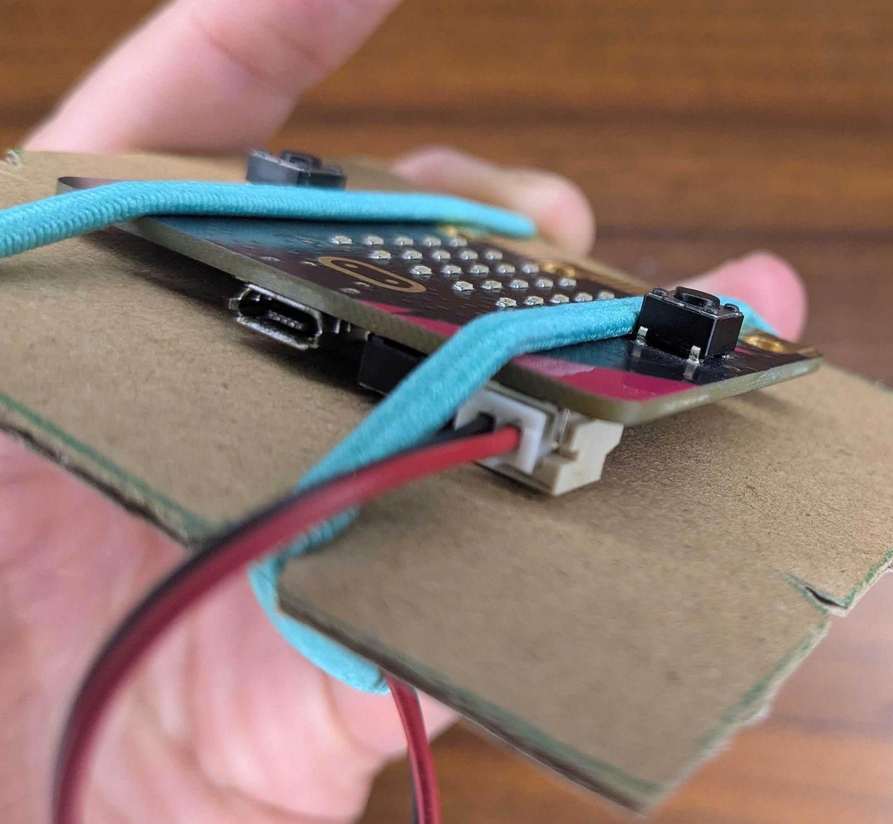
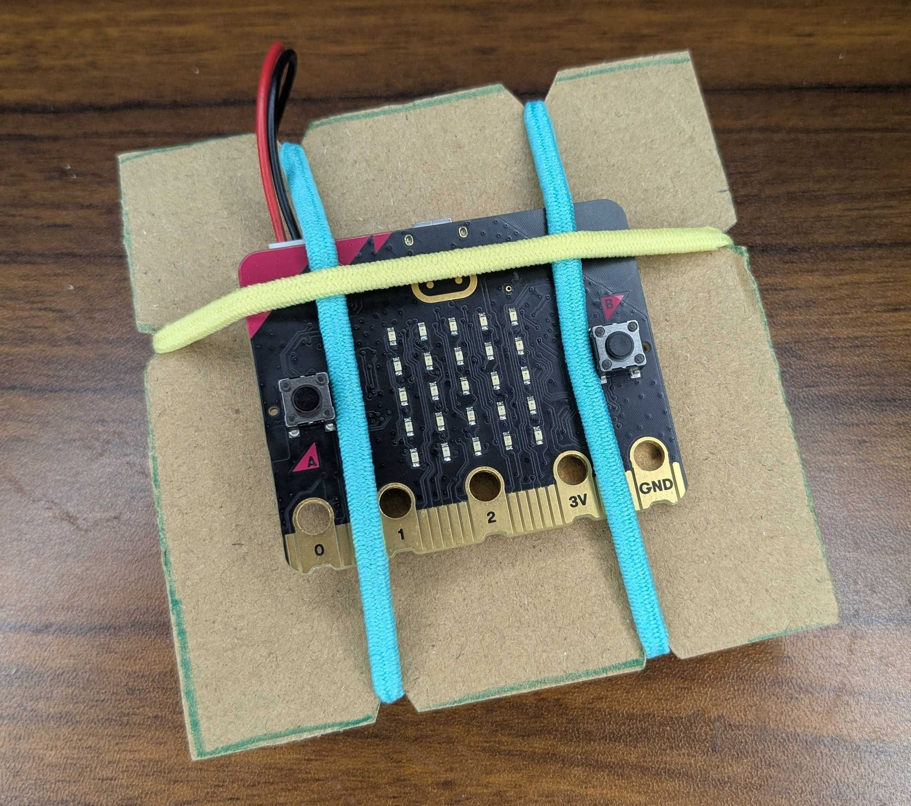
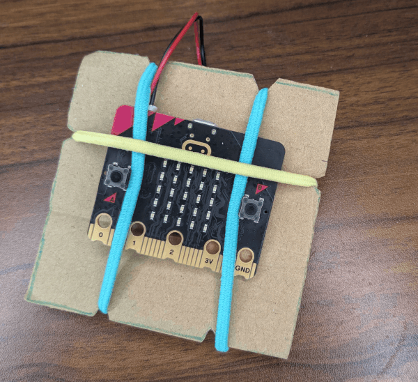

## Make your wearable

Build a holder for your micro:bit that you can wear.

> [!TASK]
>
> Draw the holder on thick cardboard.
>
> - **Print a template.** [Download the template](resources/shake-and-play-template.pdf){:target="_blank"} and print it at **actual size** or **100%**. Cut out one paper template, then draw around it on cardboard.
> - **Measure and draw.** No printer? Use the measurements on the [template](resources/shake-and-play-template.pdf){:target="_blank"} to draw the shape straight on to the cardboard with a ruler.
>
> {:width="450px"}
>
> {:width="450px"}

> [!TIP]
>
> If you have the tools, you can 3D print or laser cut the template.
>
> - **Laser cut.** [Download the laser cutting file](resources/shake-and-play-template.svg){:target="_blank"}. Use it as a template, or as your board.
> - **3D print.** [Download the 3D printing file](resources/shake-and-play-template.stl){:target="_blank"}. It prints flat and is 3 mm thick. Use it as a template, or as your board.

> [!TASK]
>
> Put the micro:bit in the middle of your outline to see which parts of the cardboard show. Draw lightly around it, then move it aside.
>
> Decorate the cardboard to make it your own. Try patterns, colours or a character.
>
> {:width="450px"}

> [!TASK]
>
> Cut out your board, including the small notches for the elastics.
>
> If you add shapes around the edge, keep the notches in the same places.
>
> {:width="450px"}
>
> {:width="450px"}

> [!TASK]
>
> Tape the battery pack to the board.
>
> {:width="450px"}

> [!TASK]
>
> Put the micro:bit on the other side, in the middle of the board.
>
> Stretch two hair elastics over the micro:bit and into the notches at the top and bottom.
>
> {:width="450px"}

> [!TIP]
>
> Keep the USB port clear of the elastics so you can still use it.

> [!TASK]
>
> Plug the battery pack into the micro:bit. Keep it plugged in, even when the USB cable is in.
>
> {:width="450px"}

> [!TASK]
>
> Hold the USB plug, not the cable, and gently pull it out of the micro:bit.

> [!TASK]
>
> Stretch the third hair elastic across the micro:bit and into the notches on each side.
>
> {:width="450px"}

> [!TASK]
>
> Wear the board on your wrist, so that you can use your arm to control it.
>
> {:width="450px"}

> [!TIP]
>
> To switch off your wearable, unplug the battery pack.

**Test:** Twist your wrist, then shake it gently. Does the micro:bit stay in place?

{:width="450px"}
