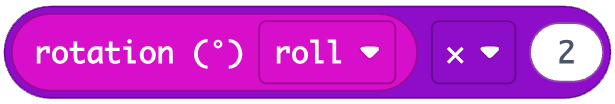
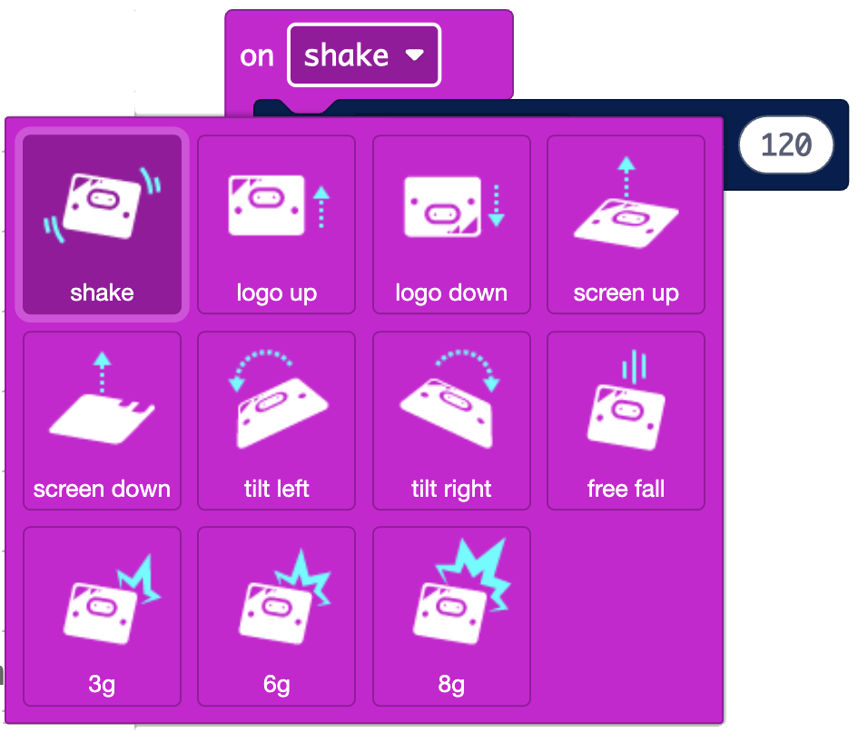
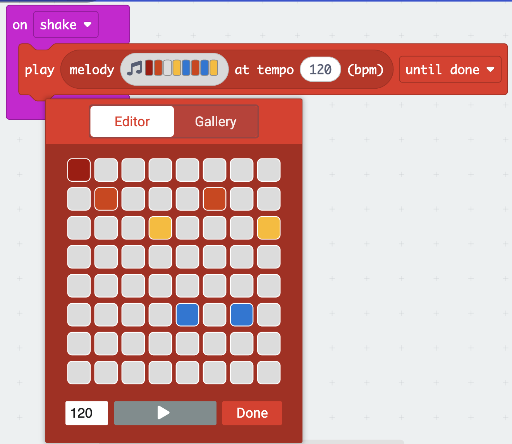

## Challenges

> [!TASK]
>
> ### Amplify the movement
>
> Use the `multiply`{:class='microbitmath'} block from the `Math`{:class='microbitmath'} menu with the tilt to increase the movement. Try different numbers instead of `2`.
>
> {:width="300px"}

> [!TASK]
>
> ### Experiment with other movements 
>
> Click the drop-down menu in the `on shake`{:class='microbitinput'} block to see the choices, then download to the board. 
>
> {:width="450px"}

> [!TASK]
>
> ### Use a different tilt
>
> Try `pitch`{:class='microbitinput'}, then tip the micro:bit forwards and backwards to change the tempo.

> [!TASK]
>
> ### Try a different sensor
>
> Add different sensors in the tempo, like `acceleration (mg) x`{:class='microbitinput'} or `light level`{:class='microbitinput'}. 

> [!TASK]
>
> ### Make a melody
>
> Use the `play melody`{:class='microbitmusic'} block from the `Music`{:class='microbitmusic'} menu. Click the melody to open the editor and make your own sound.
>
> {:width="450px"}
